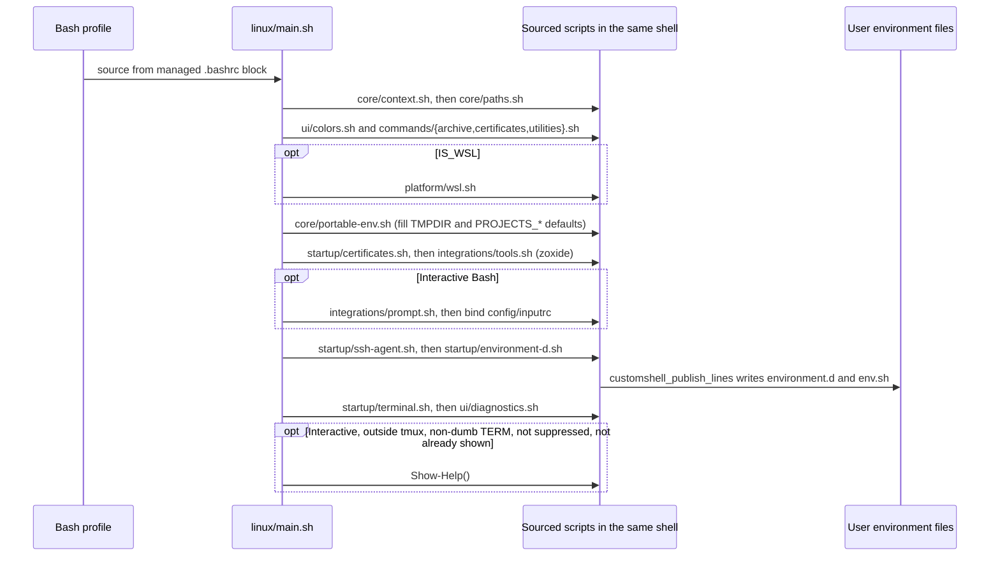
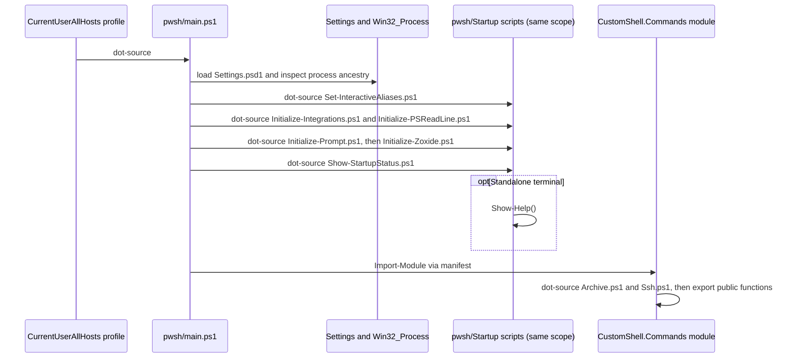
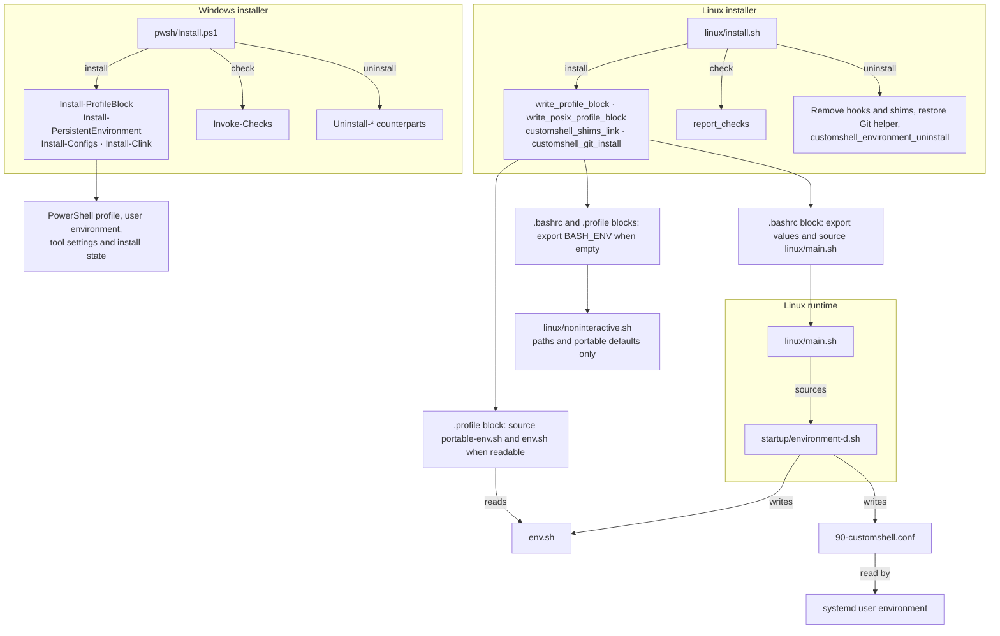
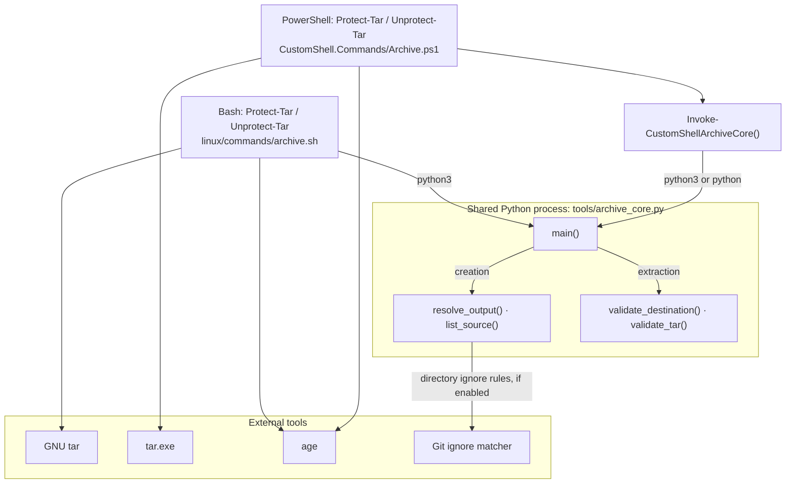
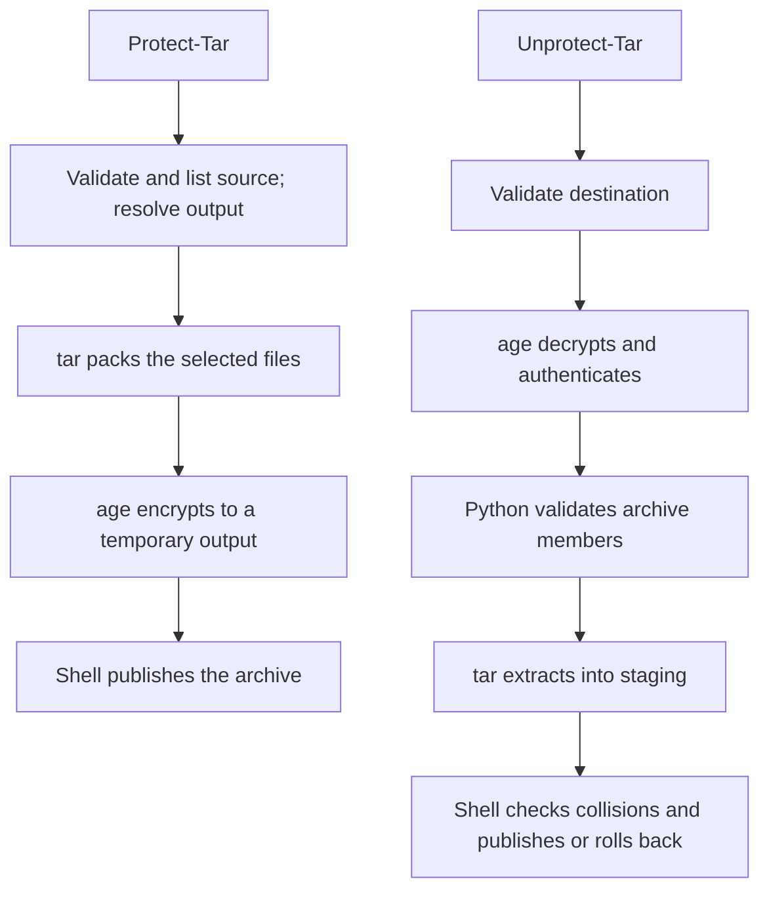
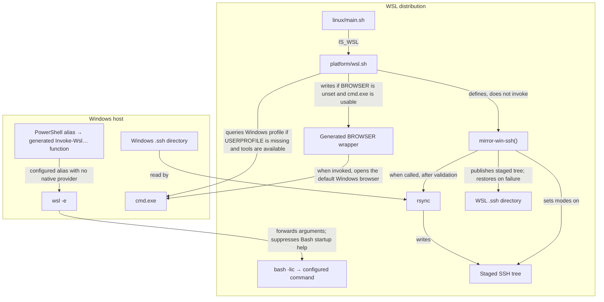

# CustomShell call flows

These diagrams show selected calls and dependencies in the current code.
For behaviour and options, see [requirements](REQUIREMENTS.md) and
[command contracts](INTERFACES.md).

## Bash startup

Sources: [entry point](../linux/main.sh#L12-L48),
[zoxide initialization](../linux/integrations/tools.sh#L64-L74),
[prompt initialization](../linux/integrations/prompt.sh),
[environment publication](../linux/startup/environment-d.sh#L75-L98).

## PowerShell startup

The command module can also be imported without running `pwsh/main.ps1`.
Sources: [entry point](../pwsh/main.ps1#L12-L62),
[startup status](../pwsh/Startup/Show-StartupStatus.ps1#L28-L30),
[command module](../pwsh/Modules/CustomShell.Commands/CustomShell.Commands.psm1).

## Setup and environment ownership

Installers write hooks for later shells; they do not execute startup as part of
installing. Sources: [PowerShell mode dispatch](../pwsh/Install.ps1#L94-L151),
[Bash hook generation and mode dispatch](../linux/install.sh#L99-L147),
[Linux runtime publisher](../linux/startup/environment-d.sh),
[environment ownership decision](ADR.md#adr-0001-installer-owned-environment-values-runtime-publication).

Non-interactive Bash never loads `linux/main.sh`. The managed blocks export
`BASH_ENV` to
[`linux/noninteractive.sh`](../linux/noninteractive.sh), which composes only
`core/paths.sh` and `core/portable-env.sh`. Keeping it separate is deliberate:
`main.sh` starts the SSH agent, selects a prompt, and may print startup help,
which build tools and agent shells must not see. A launch that runs no profile
at all, such as a Windows to WSL interoperability process, still bypasses both
entry points; see [ADR-0003](ADR.md#adr-0003-non-interactive-bash-environment-through-bash_env).

## Archive commands

Python owns validation and source selection. The shell front ends call
`tar` and `age` and own staging and publication.
Sources: [Bash front end](../linux/commands/archive.sh),
[PowerShell front end](../pwsh/Modules/CustomShell.Commands/Archive.ps1),
[Python dispatch](../tools/archive_core.py#L415-L493).

## WSL boundary

Sources: [PowerShell wrapper](../pwsh/Startup/Set-InteractiveAliases.ps1#L76-L133),
[WSL startup helpers](../linux/platform/wsl.sh#L12-L75),
[mirror call](../linux/platform/wsl.sh#L110-L204).
